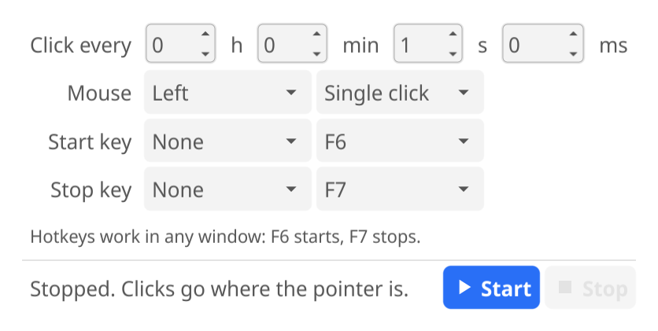

# AutMouseClicker

An auto clicker for Linux. It clicks where the mouse pointer is, at an interval you choose, and starts and stops
from hotkeys that work in any window.



## Install

```sh
curl -fsSL https://raw.githubusercontent.com/grangedevgroup-code/AutMouseClicker/main/install.sh | sh
```

The script downloads the latest release for your machine (x86-64 or ARM64), checks its SHA-256 sum, copies the
program to `~/.local/bin` and adds AutMouseClicker to the app menu and the desktop. It needs no root access.

Or download `autmouseclicker-linux-amd64.tar.gz` (or `-arm64`) from
[Releases](https://github.com/grangedevgroup-code/AutMouseClicker/releases), extract it and run:

```sh
./autmouseclicker/autmouseclicker install
```

To remove it, run `autmouseclicker uninstall`. Your settings stay in `~/.config/fyne`.

## Use

1. Set how often to click (hours, minutes, seconds and milliseconds, at least 10 ms), the mouse button, and single
   or double click. The arrows, the Up and Down keys and the mouse wheel change the numbers.
2. Point at what you want clicked and press the start hotkey (F6 unless you change it), or press Start.
3. Press the stop hotkey (F7) to stop. Pick the same key for both to make one key start and stop.

The tray icon has Start and Stop as well and turns red while clicking. Only one window runs at a time: opening the
app again brings the window forward.

### Desktops

| Desktop | Clicking | Hotkeys |
|---|---|---|
| KDE Plasma, Wayland | desktop portal (Plasma asks for permission) | KDE global shortcuts |
| KDE Plasma, X11 | XTEST | KDE global shortcuts |
| GNOME and other Wayland desktops | desktop portal (asks for permission) | global shortcuts portal |
| Other X11 desktops | XTEST | X11 key grabs |

If a hotkey is already taken, the window names the shortcut that holds it. On KDE, Ctrl+F1 to Ctrl+F4 switch
virtual desktops by default, which is why the defaults are plain F6 and F7.

### Command line

```sh
autmouseclicker click --interval 250ms --button left --count 100
```

`autmouseclicker help` lists every option.

## Build from source

You need Go 1.27 or newer and the OpenGL, X11 and Wayland headers. On Debian and Ubuntu:

```sh
sudo apt install libgl1-mesa-dev xorg-dev libwayland-dev libxkbcommon-dev
go build -trimpath -o autmouseclicker .
go test -race ./...
```

## Plans

Builds for macOS and Windows come next.

## License

MIT, see [LICENSE](LICENSE).
